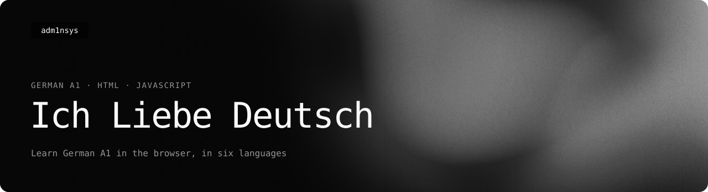

<picture>
  <source media="(prefers-color-scheme: light)" srcset=".github/readme/banner-light.svg">
  
</picture>

<p>
  <a href="https://adm1nsys.github.io/Ich-Liebe-Deutsch/"></a>
  <a href="LICENSE"></a>
</p>

A website for learning German at level A1: short explanations, exercises and tests, all in the browser.
No account and no server — progress and settings are kept in the browser's local storage.

**[Open it →](https://adm1nsys.github.io/Ich-Liebe-Deutsch/)**

## What is there

The home page groups everything into modules:

- **Zur Information** — the alphabet, pronunciation, and the full vocabulary list.
- **Tests** — typing speed and word dictation.
- **VHS: Schritt für Schritt 1** — lessons 1–7, alongside the course book.
- **A1.1 Foundation** — pronouns, present-tense conjugation, *haben* and *sein*, numbers, time and dates,
  basic structures (*das ist*, *es gibt*, *ich möchte*).
- **Sentence Builder (A1–B1+)** — statements, questions, question words, negation, modal verbs, separable verbs,
  prepositions.
- **Articles, Cases & Pronouns (A1–B1+)** — articles in all cases, possessive pronouns, nominative, accusative,
  plural nouns.

Some topics have their own page with an explanation; the others open in a shared practice mode. Answers are given
by tapping blocks or by typing. There is a search across modules, rules and words, **statistics** of what has been
practised, and **settings** for the interface language and colour themes.

**Interface languages:** English, Deutsch, Українська, Čeština, Polski, Dansk.

## Status

A personal learning project, built while learning German myself, and still rough. It is a single-page app put
together page by page — plain HTML and JavaScript, no framework and no build step, with each page's styles inside
its script.

I built the code and the interface myself. The content I did not: when I started, I knew zero German, literally zero,
so I had no way to check whether a sentence was right. The word lists, example sentences and grammar were written by an
AI; I no longer remember which model.

The idea was simple: in my VHS German course we covered a topic in class. I gave the AI that topic, it built a trainer
for it, and at home I practised with it, against the clock, until I knew it. If I develop the trainer further, it will
most likely be with AI only: I want to spend my time learning German, not building the tool.

## Run locally

Any static web server in the repository folder, for example:

```bash
python3 -m http.server 8080
```

then open http://localhost:8080.

## License

[MIT](LICENSE)
